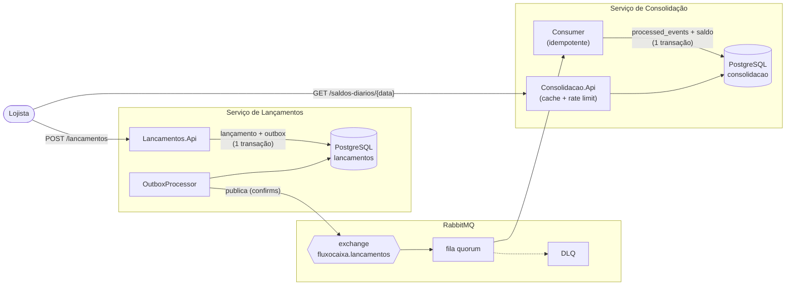

# Fluxo de Caixa — Lançamentos e Saldo Diário Consolidado

Solução em **C# / .NET 10** para o controle de fluxo de caixa de um lojista: registro de créditos e débitos
(com estorno) e um relatório de **saldo diário consolidado**.

Foco do projeto: **arquitetura limpa e testável** — DDD (Evans), CQRS, SOLID, mensageria com
Transactional Outbox, resiliência e testes automatizados (unitários, integração com containers reais,
arquitetura e carga).

- [Visão geral da arquitetura](#visão-geral-da-arquitetura)
- [Como executar](#como-executar)
- [Roteiro de demonstração](#roteiro-de-demonstração-5-minutos)
- [Testes](#testes)
- [Requisitos não funcionais: como são atendidos](#requisitos-não-funcionais-como-são-atendidos)
- [Decisões de negócio](#decisões-de-negócio-ambiguidades-do-enunciado)
- [Decisões técnicas (ADRs)](#decisões-técnicas-adrs)
- [Estrutura do repositório](#estrutura-do-repositório)
- [Limitações conhecidas](#limitações-conhecidas)
- [Evolução para produção](#evolução-para-produção)

---

## Visão geral da arquitetura

Dois serviços independentes, **cada um com seu banco PostgreSQL**, integrados **apenas por eventos** (RabbitMQ).
Não existe chamada síncrona entre eles — por isso a falha de um não derruba o outro.



Diagramas completos (C4, camadas, sequência e tratamento de falhas): [docs/diagrams](docs/diagrams).

### Camadas (por serviço)

| Projeto | Responsabilidade |
|---|---|
| `*.Api` | Controllers finos, filtros (idempotência), `ProblemDetails`, Swagger, health checks, rate limiting. **Nenhuma regra de negócio.** |
| `*.Application` | **Casos de uso em CQRS**: `Command/Query` + `Handler` + `Validator`. Decorators de logging, validação e transação. Portas (interfaces) de infraestrutura. |
| `*.Domain` | **DDD**: Aggregate Roots (`Lancamento`, `SaldoDiario`), Value Objects (`Money`, `Descricao`), eventos de domínio, interfaces de repositório e erros de negócio. Sem dependência de framework. |
| `*.External` | Infraestrutura: repositórios e queries **Dapper**, scripts SQL + **DbUp**, RabbitMQ, Outbox, cache, resiliência (Polly). Implementa as interfaces do Domain/Application. |
| `FluxoCaixa.BuildingBlocks` (+ `.Application`, `.Infrastructure`, `.Api`) | *Shared Kernel* mínimo (`Entity`, `AggregateRoot`, `ValueObject`, `Money`, `Result`, interfaces CQRS) e a infraestrutura comum aos dois serviços, separada por motivo de mudança: decorators e `AddCqrs`; sessão Dapper/migrator DbUp/conexão RabbitMQ; `ProblemDetails`, correlação e health checks. [ADR 0008](docs/adr/0008-shared-kernel-minimo.md). |

A regra de dependência (`Api → Application → Domain`, `External → Application/Domain`, serviços nunca se referenciam)
é **verificada por testes de arquitetura** (NetArchTest) a cada build.

---

## Como executar

### Pré-requisitos

- **Docker** 24+ com Docker Compose v2 (suficiente para rodar tudo).
- Para rodar testes ou desenvolver localmente: **.NET SDK 10** (`global.json`). Os testes de integração usam
  Testcontainers, então também precisam do Docker em execução.

### Subir a aplicação completa

```bash
docker compose up --build
```

O primeiro build baixa imagens e pacotes. Ao final:

| O quê | URL |
|---|---|
| **Swagger — Lançamentos** | http://localhost:5001/swagger |
| **Swagger — Consolidação** | http://localhost:5002/swagger |
| Painel do RabbitMQ | http://localhost:15672 (usuário `fluxo` / senha `fluxo`) |
| PostgreSQL | `localhost:5432` (usuário/senha `fluxo`; bancos `lancamentos` e `consolidacao`) |
| Health | `/health/live`, `/health/ready` e `/health/dependencies` em cada API |

As tabelas são criadas automaticamente: cada serviço aplica seus scripts SQL
(`src/*/*.External/Database/Scripts/*.sql`) no startup via DbUp.

Para parar e limpar tudo (inclusive os dados): `docker compose down -v`.

### Rodar as APIs fora do Docker (opcional)

```bash
docker compose up -d postgres rabbitmq
dotnet run --project src/Lancamentos/Lancamentos.Api --urls http://localhost:5001
dotnet run --project src/Consolidacao/Consolidacao.Api --urls http://localhost:5002
```

(O ambiente `Development` já habilita o Swagger e os `appsettings.json` apontam para `localhost`.)

---

## Roteiro de demonstração (5 minutos)

```bash
HOJE=$(date +%F)

# 1) Registrar um crédito (Idempotency-Key é obrigatória)
curl -s -X POST localhost:5001/api/v1/lancamentos \
  -H 'Content-Type: application/json' -H "Idempotency-Key: $(uuidgen)" \
  -d "{\"tipo\":\"Credito\",\"valor\":1000.00,\"descricao\":\"Venda do dia\",\"dataCompetencia\":\"$HOJE\"}"

# 2) Registrar um débito
curl -s -X POST localhost:5001/api/v1/lancamentos \
  -H 'Content-Type: application/json' -H "Idempotency-Key: $(uuidgen)" \
  -d "{\"tipo\":\"Debito\",\"valor\":250.50,\"descricao\":\"Fornecedor\",\"dataCompetencia\":\"$HOJE\"}"

# 3) Consultar o saldo consolidado (aparece em instantes: consistência eventual)
curl -s localhost:5002/api/v1/saldos-diarios/$HOJE
# {"data":"…","totalCreditos":1000.00,"totalDebitos":250.50,"saldoDoDia":749.50,"saldoAcumulado":749.50,…}

# 4) Relatório de um período (um item por dia, com acumulado)
curl -s "localhost:5002/api/v1/saldos-diarios?de=$(date -v-6d +%F)&ate=$HOJE"   # Linux: date -d '6 days ago' +%F

# 5) Estornar um lançamento (nunca se edita/exclui: cria um lançamento inverso)
curl -s -X POST localhost:5001/api/v1/lancamentos/<ID>/estornos \
  -H 'Content-Type: application/json' -d '{"motivo":"Lançado por engano"}'
```

### Provando o isolamento de falha (requisito principal)

```bash
docker compose stop consolidacao-api          # derruba o serviço de consolidação

# Os lançamentos CONTINUAM sendo aceitos (201):
curl -i -X POST localhost:5001/api/v1/lancamentos -H 'Content-Type: application/json' \
  -H "Idempotency-Key: $(uuidgen)" \
  -d "{\"tipo\":\"Credito\",\"valor\":100.00,\"descricao\":\"Durante a queda\",\"dataCompetencia\":\"$HOJE\"}"

docker compose start consolidacao-api         # sobe de novo
curl -s localhost:5002/api/v1/saldos-diarios/$HOJE   # as mensagens acumuladas são consumidas e o saldo converge
```

O mesmo vale para o RabbitMQ (`docker compose stop rabbitmq`): o `POST` segue retornando `201` e os eventos ficam na tabela
`outbox_messages` até o broker voltar. Isso é coberto por testes automatizados (abaixo).

---

## Testes

```bash
dotnet test        # todos (os de integração sobem PostgreSQL e RabbitMQ reais via Testcontainers)
```

| Projeto | Tipo | O que garante |
|---|---|---|
| `FluxoCaixa.BuildingBlocks.Tests` | unitário | `Money` (2 casas, não negativo, igualdade), `Result`. |
| `FluxoCaixa.BuildingBlocks.Application.Tests` | unitário | Decorators de **validação** (não chama o handler, agrega mensagens) e de **transação** (commit/rollback, ordem begin→commit), com comando fictício. |
| `Lancamentos.Domain.Tests` | unitário | Invariantes do `Lancamento`, regra de data no fuso de São Paulo, estorno (inverso, vínculo, duplo estorno, estorno de estorno), eventos de domínio. |
| `Lancamentos.Application.Tests` | unitário | Handlers (persistência + outbox), validators, decorators de validação e **transação** (commit/rollback), mapper de eventos. |
| `Consolidacao.Domain.Tests` | unitário | `SaldoDiario`: soma, saldo negativo, **ordem dos movimentos não altera o resultado**. |
| `Consolidacao.Application.Tests` | unitário | Idempotência do handler, saldo de dia sem movimento, relatório com dias vazios e acumulado, validação de datas. |
| `Lancamentos.IntegrationTests` | integração | Migrations, `201`+`Location`, lançamento e outbox **na mesma transação**, **idempotência** (replay, corpo diferente → `422`, 8 requisições concorrentes → 1 lançamento), estorno concorrente (1 sucesso, 5 conflitos), **RabbitMQ fora do ar → `201`**, outbox publica/retém/reentrega. |
| `Consolidacao.IntegrationTests` | integração | Consumo atualiza o saldo, **mensagem duplicada aplicada 1×**, **100 mensagens concorrentes → soma exata**, JSON inválido / tipo desconhecido → **DLQ**, retroativo corrige o acumulado, relatório, `429` com `Retry-After`. |
| `FluxoCaixa.ArchitectureTests` | arquitetura | Domain sem dependências de infra/framework; Application sem External/Api; **Lançamentos ⟂ Consolidação**; BuildingBlocks sem dependência de infraestrutura nem de serviços; handlers `sealed`; controllers só na camada Api. Inclui controle de sanidade contra regras vacuamente verdadeiras. |

### Teste de carga (50 req/s, perda máxima de 5%)

Com a stack no ar (`docker compose up -d`), o k6 aplica **50 req/s constantes** no `GET /saldos-diarios/{data}` **enquanto**
20 lançamentos/s entram em paralelo (a consolidação lê e escreve ao mesmo tempo):

```bash
docker compose --profile load run --rm k6                  # 2 min (padrão)
docker compose --profile load run --rm -e DURATION=30s k6  # versão curta
```

Critérios (thresholds): `http_req_failed < 5%`, `p95 < 200 ms`, `p99 < 500 ms`.

**Resultado de uma execução local** (Docker Desktop no macOS, APIs com `ASPNETCORE_ENVIRONMENT=Development`, 60 s):

| Cenário | Requisições | Falhas | Latência (p95 / p99) |
|---|---|---|---|
| `leitura` — 50 req/s em `GET /saldos-diarios/{data}` | 3.001 | **0,00 %** (limite: 5 %) | **6,4 ms** / 22,6 ms (limites: 200 / 500 ms) |
| `escrita` — 20 req/s em `POST /lancamentos` (em paralelo) | 1.201 | 0,00 % | não medido isoladamente (p95 geral das 2 cargas: 12,6 ms) |

Todos os thresholds passaram; nenhuma iteração descartada. Os números dependem da máquina — o objetivo é demonstrar a folga
em relação ao requisito (50 req/s) e fornecer um teste reproduzível, não um *benchmark* absoluto.


---

## Requisitos não funcionais: como são atendidos

### 1. "Lançamentos continua operante se a consolidação falhar"

- **Zero acoplamento síncrono**: Lançamentos nunca chama a Consolidação. A única integração é um evento.
- **Transactional Outbox**: o lançamento e o evento são gravados na mesma transação (ADR 0002). Se o RabbitMQ ou a
  Consolidação estiverem fora, o evento espera no banco e é publicado depois, com *retry* exponencial e *circuit breaker* (Polly).
- **Sem perda por fila inexistente**: a publicação usa `mandatory` + *publisher confirms*; se a Consolidação ainda não
  declarou sua fila, a mensagem não some — fica pendente no outbox.
- **Readiness correto**: `/health/ready` depende só do PostgreSQL; broker indisponível apenas *degrada* `/health/dependencies`.

### 2. "50 req/s no pico, perda máxima de 5%"

- A leitura é uma consulta por chave primária (+ um `SUM` sobre poucas linhas) numa tabela **já consolidada** — o custo por
  requisição é mínimo e independente do volume de lançamentos.
- **HybridCache** com coalescimento: N requisições simultâneas à mesma chave geram **uma** consulta ao banco; TTL curto (5 s) e
  invalidação após cada consolidação.
- **Rate limiter (token bucket)**: protege contra picos muito acima do contratado respondendo `429` + `Retry-After` em vez de
  degradar todas as requisições. Dimensionado para sustentar 50 req/s com folga (100 tokens/s de reposição, rajada de 200).
- Pool de conexões (`NpgsqlDataSource`), I/O 100% assíncrono e consumo com *prefetch* e concorrência configuráveis.
- **Prova**: teste de carga k6 com thresholds (acima).

### 3. Consistência e corretude

- **Consumidor idempotente** (`processed_events` na mesma transação do saldo) e **sem perda de atualização** (`FOR UPDATE`) — ADR 0005.
- **Estorno em vez de edição**: trilha de auditoria íntegra (ADR 0006).
- **Idempotência na API**: header `Idempotency-Key` no `POST /lancamentos`; reserva a chave *antes* de executar, evitando a corrida de requisições simultâneas.

---

## Decisões de negócio (ambiguidades do enunciado)

| Ponto | Decisão |
|---|---|
| "Saldo diário consolidado" | A API devolve **`saldoDoDia`** (créditos − débitos) **e `saldoAcumulado`** (soma até a data). |
| Qual data define o dia | **Data de competência** informada no lançamento. Fuso de negócio: `America/Sao_Paulo`. |
| Data futura / retroativa | Futura é rejeitada; retroativa é permitida (o acumulado dos dias seguintes se ajusta, pois é calculado na leitura). |
| Editar/excluir | Não existe. Correção por **estorno** (lançamento inverso vinculado ao original, com data de competência *hoje*). |
| Dia sem movimento | `200` com totais zerados (e acumulado herdado), não `404`. |
| Dinheiro | `decimal`/`numeric(18,2)`, positivo, até 2 casas. O tipo (Crédito/Débito) define o sinal. |

Detalhes e justificativas: [ADR 0007](docs/adr/0007-data-de-competencia-e-fuso.md).

---

## Decisões técnicas (ADRs)

| # | Decisão |
|---|---|
| [0001](docs/adr/0001-dois-servicos-independentes.md) | Dois serviços independentes, banco por serviço |
| [0002](docs/adr/0002-rabbitmq-com-transactional-outbox.md) | RabbitMQ com Transactional Outbox |
| [0003](docs/adr/0003-cqrs-sem-mediatr.md) | CQRS explícito, sem MediatR |
| [0004](docs/adr/0004-dapper-e-scripts-sql-com-dbup.md) | Dapper + scripts SQL versionados (DbUp) |
| [0005](docs/adr/0005-consistencia-eventual-e-idempotencia.md) | Consistência eventual e consumidor idempotente |
| [0006](docs/adr/0006-estorno-em-vez-de-edicao.md) | Estorno em vez de edição/exclusão |
| [0007](docs/adr/0007-data-de-competencia-e-fuso.md) | Data de competência, fuso e saldo diário |
| [0008](docs/adr/0008-shared-kernel-minimo.md) | Shared Kernel mínimo e contratos por consumidor |

### Princípios aplicados

- **DDD:** agregados com invariantes reais, Value Objects, linguagem ubíqua em português, eventos de domínio, repositórios como interfaces do Domain, contrato de integração (versionado) separado do evento de domínio.
- **SOLID:** handlers com responsabilidade única; dependências por abstração (DIP) — o Domain não conhece Dapper/RabbitMQ; decorators estendem comportamento sem alterar handlers (OCP).
- **Padrões:** Repository, Unit of Work, Transactional Outbox, Decorator, Result, Idempotent Receiver, Dead Letter Channel, Circuit Breaker/Retry.
- **Clean Code:** nomes do negócio, métodos curtos, erros como valores (`Result<T>`) e catálogos de erro com códigos estáveis expostos no `ProblemDetails` (`code`).

---

## Estrutura do repositório

```
├── docker-compose.yml            # postgres, rabbitmq, 2 APIs (+ k6 no profile "load")
├── docker/postgres/init/         # criação dos bancos
├── docs/
│   ├── adr/                      # decisões de arquitetura
│   ├── diagrams/                 # C4, camadas, sequência (Mermaid)
├── src/
│   ├── BuildingBlocks/                  # Kernel + .Application + .Infrastructure + .Api
│   ├── Lancamentos/{Domain,Application,External,Api}/
│   │   └── Lancamentos.External/Database/Scripts/   # 0001_*.sql … (DbUp)
│   └── Consolidacao/{Domain,Application,External,Api}/
│       └── Consolidacao.External/Database/Scripts/
└── tests/
    ├── *.Domain.Tests  *.Application.Tests  *.IntegrationTests
    ├── FluxoCaixa.ArchitectureTests/
    └── load/k6/saldo-diario.js
```

---

## Limitações conhecidas

Registradas com honestidade, como pontos de partida para evolução:

- **Sem autenticação/autorização** e sem multi-tenant (um único lojista). Em produção: OAuth2/JWT, `lojistaId` no agregado e nos índices.
- **`processed_events`, `idempotency_keys` e `outbox_messages` processadas não são expurgadas** (falta uma rotina de retenção).
- **Reconciliação**: não há job que recalcule `saldo_diario` a partir dos lançamentos para detectar divergências (descrito no ADR 0005).
- **Invalidação de cache total** a cada consolidação. Correto (um retroativo muda o acumulado de todos os dias seguintes), mas reduz o aproveitamento do cache sob muita escrita; o ganho principal no pico é o coalescimento.
- **Acumulado calculado com `SUM`** sobre todos os dias anteriores: O(dias). Suficiente aqui; com anos de histórico, usar snapshots/saldo de abertura mensal.
- **Sem política de reprocessamento da DLQ** (hoje, inspeção manual no painel do RabbitMQ).
- Observabilidade limitada a logs estruturados (Serilog) com `X-Correlation-Id` e health checks; sem métricas/tracing distribuído.
- Segredos de desenvolvimento em texto no `docker-compose.yml`/`appsettings` (apenas para o ambiente local).

## Evolução para produção

| Tema | Próximo passo | Gatilho que justifica |
|---|---|---|
| Observabilidade | OpenTelemetry (traces com propagação pelo outbox/mensagem, métricas), SLOs (disponibilidade do `POST`, *freshness* do saldo) | Primeiro ambiente compartilhado |
| Entrega de eventos | CDC (Debezium) no lugar do polling do outbox; Kafka se houver múltiplos consumidores/replay | Volume > centenas de msg/s ou novos consumidores |
| Leitura | Saldo de abertura (snapshot) por mês; réplica de leitura; cache distribuído (Redis) no HybridCache | Histórico longo / múltiplas instâncias |
| Segurança | OAuth2/JWT, multi-tenant, criptografia de dados sensíveis, segredos em cofre | Antes de qualquer exposição real |
| Corretude | Job de reconciliação + alerta de divergência; retenção/expurgo | Operação contínua |
| Entrega | Pipeline CI/CD com *deploy* canário, health checks no orquestrador (Kubernetes), HPA na Consolidação | Produção |
| Conformidade | LGPD (retenção/anonimização), trilha de auditoria imutável com assinatura | Ambiente regulado |
