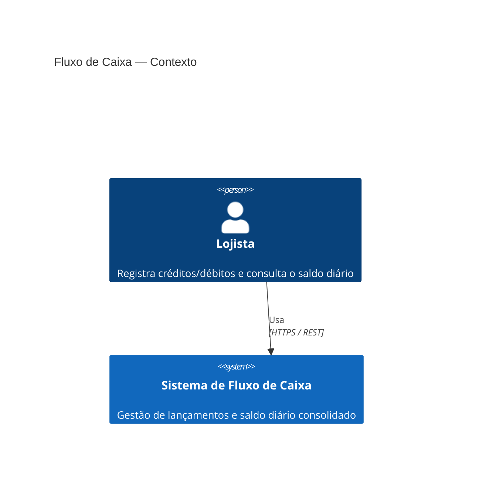
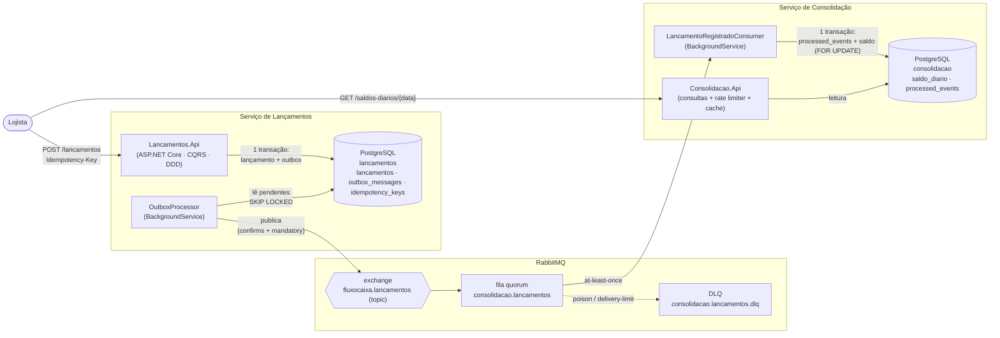
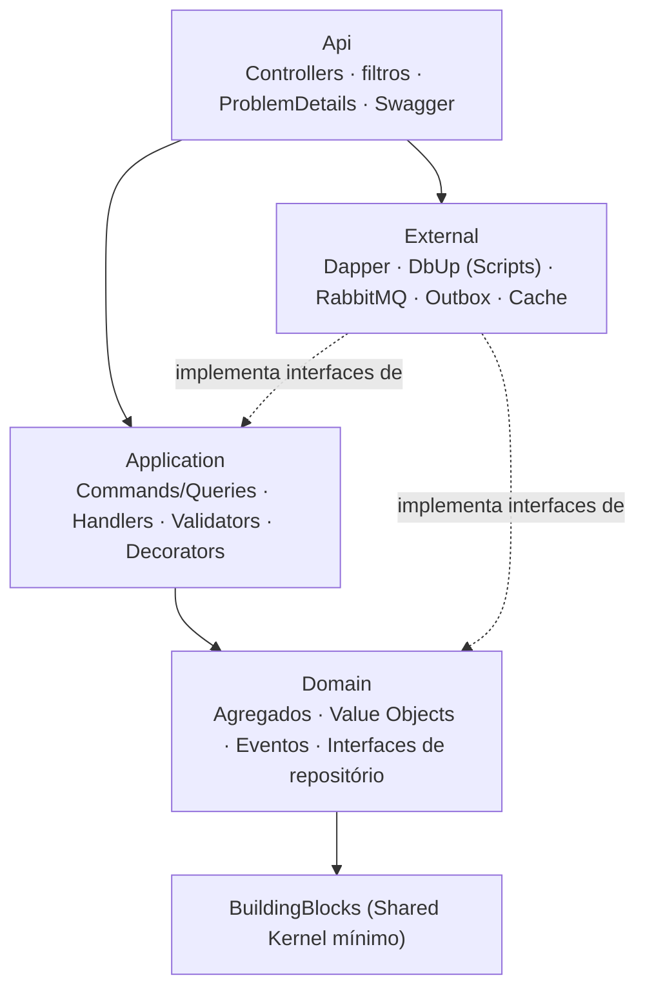

# Diagramas de arquitetura (C4)

## Nível 1 — Contexto

## Nível 2 — Containers

> **Isolamento:** não existe nenhuma seta entre `Lancamentos.Api` e `Consolidacao.*`. Se a Consolidação ou o broker caírem,
> o `POST` continua gravando; as mensagens esperam no `outbox_messages`.

## Camadas de cada serviço

