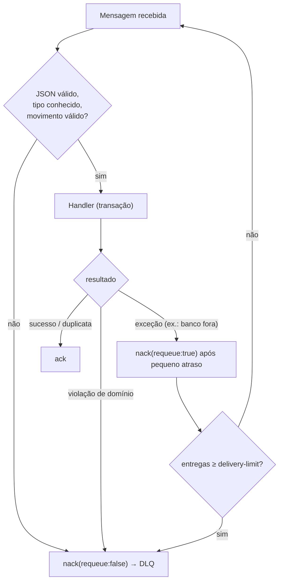

# Sequência — registrar lançamento até o saldo consolidado

```mermaid
sequenceDiagram
    autonumber
    participant C as Lojista
    participant API as Lancamentos.Api
    participant DB as lancamentos (PG)
    participant OP as OutboxProcessor
    participant MQ as RabbitMQ
    participant CO as Consumer (Consolidação)
    participant CDB as consolidacao (PG)
    participant CAPI as Consolidacao.Api

    C->>API: POST /api/v1/lancamentos (Idempotency-Key)
    API->>DB: reserva a chave de idempotência
    API->>DB: BEGIN; INSERT lancamento; INSERT outbox; COMMIT
    API-->>C: 201 Created (+ Location)

    loop a cada 1 s (ou imediatamente se houver lote cheio)
        OP->>DB: claim: UPDATE locked_until=now()+lease … SKIP LOCKED (commit imediato)
        OP->>MQ: publish (mandatory + publisher confirm) — fora de transação
        alt broker fora do ar OU sem fila vinculada
            OP->>DB: attempts++, libera a mensagem e o resto do lote; backoff
        else confirmado
            OP->>DB: processed_at = now()
        end
    end

    MQ->>CO: LancamentoRegistrado (at-least-once)
    CO->>CDB: BEGIN; INSERT processed_events ON CONFLICT DO NOTHING
    alt evento novo
        CO->>CDB: saldo_diario FOR UPDATE → aplica → UPDATE; COMMIT
        CO->>CO: invalida cache (após o commit)
    else duplicata
        CO->>CDB: COMMIT (nada a fazer)
    end
    CO->>MQ: ack

    C->>CAPI: GET /api/v1/saldos-diarios/{data}
    CAPI-->>C: 200 {totalCreditos, totalDebitos, saldoDoDia, saldoAcumulado}
```

## Falhas tratadas


